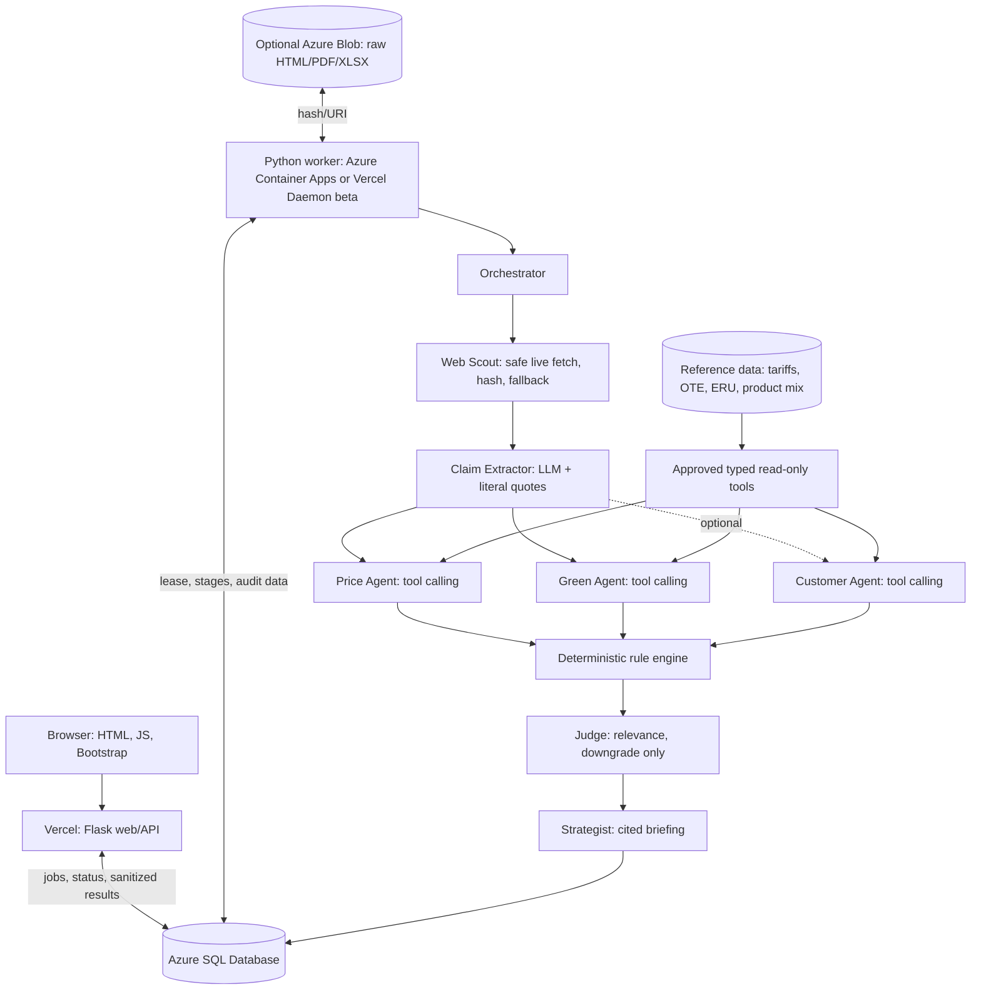

# Fact or Watt — architecture v3 (Flask + src + Azure SQL + Vercel)

**Status:** target architecture, not a statement that every component is implemented. This revision preserves the reviewed v2 multiagent methods while updating persistent storage, repository structure and deployment. See `API_CONTRACTS.md` and `RULE_CATALOG.md` for normative domain semantics.

## 1. Goal and KIQs

**KIT:** Kde se marketingová tvrzení konkurenčních dodavatelů elektřiny rozcházejí s ověřitelnými daty a jakou příležitost to dává našemu positioningu?

| KIQ | Question | Responsible roles |
|---|---|---|
| 1 | Jaká tvrzení konkurenti komunikují na svých webech? | Web Scout, Claim Extractor |
| 2 | Která cenová tvrzení obstojí proti ceníkům? | Price agent |
| 3 | Která ekologická tvrzení jsou doložená a mohou nést regulatorní riziko? | Green agent |
| 4 | Odpovídají tvrzení o zákaznících a spolehlivosti veřejným datům? | Customer agent (stretch) |
| 5 | Kde jsou největší mezery a jak je využít? | Judge, Strategist |

## 2. Components and deployment topology

**Vercel** serves the Flask UI and short request/response APIs. **Azure SQL Database** (MSSQL assumed until resource type confirmation) persists audits, jobs, claims, evidence, verdicts, source metadata and publication pointers. The **worker** is a separate process that continues independently of web requests; recommended host is Azure Container Apps. Vercel Daemons are a newer beta alternative, not included in the minimal deployment configuration. Use Azure Blob Storage for potentially large immutable raw artifacts; do not rely on local files in a Vercel Function.

## 3. Source intake and agent boundaries

- **Web Scout** is deterministic Python, not an LLM. For each live audit fetch approved 2–4 URLs/supplier, canonicalize and hash source text. On successful fetch with an approved identical baseline, reuse checked claims. On changed content, call Claim Extractor. If fetch fails and a compatible snapshot exists, use it with `origin=snapshot`, its real timestamp, and a warning. Never claim that backup is live content.
- **Claim Extractor** returns exact quotes that exist in stored source content, `source_ref` and one rule ID from the closed catalog.
- **Price/Green/Customer agents** are bounded LLMs with tool calling; tools use curated, dated reference data and deterministic functions. Agent output is typed Evidence, not unverified free-form numbers.
- **Rule engine** produces a deterministic initial verdict. **Judge** can only downgrade it to `unverifiable` on mismatch and records an explanation. **Strategist** summarizes saved evidence with `claim_id` references.
- No agent can write SQL, execute arbitrary code, request arbitrary websites, modify evidence or upgrade a rule verdict.

## 4. Source provenance and methodological invariants

Each source/evidence record should carry `source_url`, `source_ref`, `source_content_hash`, `captured_at`, `checked_at`/`valid_as_of` as appropriate, `origin` (`live | baseline | snapshot`), limitation and parser/rule versions. `human_reviewed` belongs to extracted claim review, separate from origin. Live/snapshot/fixture must be differentiated in public UI.

Four verdicts: `supported`, `partially_supported`, `contradicted`, `unverifiable`. Incomplete evidence is not contradiction. Superlative `nejlevnější v ČR` cannot be supported by 3–5 firms; a valid comparable cheaper offer can contradict it. OTE OPM does not equal unique customers; country-wide residual energy mix is not supplier product proof. Regulatory risk is a separate non-legal flag. No global supplier dishonesty score.

## 5. Persistence and durable worker

Use SQLAlchemy 2.1+ against the existing manually provisioned Azure SQL schema. Schema/seed scripts and migrations are external to the app repository. No SQLite as production persistence or implicit test substitute. Define SQLAlchemy `Supplier`, `AuditRun`, `AuditJob`, `AuditEvent`, `Source`, `SourceSnapshot`, `Claim`, `Evidence`, `Verdict`, `Publication` models as needed; enforce relational constraints and provenance. Make HTTP request handlers short: authorized `POST /api/v1/audits` inserts job and returns `202`; `GET /api/v1/audits/{id}` reads durable status/events; results and latest publication endpoints are read-only.

Worker uses atomic job claim, leases, heartbeat, retries, idempotent operations and explicit publish-on-success transaction. Persist stage events so page reloads and transient web instance restarts do not lose audit progress. Store raw PDF/HTML bytes in Blob or bounded external storage when appropriate.

Azure SQL TLS, firewall and allowed Vercel outbound connections must be explicitly configured. Vercel Static IPs are plan-dependent; do not assume a hostname/password alone grants access. For exact database setup, see `DATABASE_AZURE.md`.

## 6. Repository structure

Canonical application logic lives under `src/competitive_intelligence/`: Flask factory `app.py`, blueprints `web/`, schemas `schemas/`, models `models/`, repositories/services `services/`, connectors and parsers, `agents/`, read-only `tools/`, deterministic `rules/`, LLM adapters, templates and static assets. `src/index.py` is solely the Vercel WSGI adapter. Tests are under `tests/`, docs under `docs/`, configuration under `config/` as it is implemented. No Next.js, TypeScript or duplicate root Flask app.

## 7. UI, API and release

HTML/Jinja2/vanilla JS (Bootstrap optional): supplier/profile selection, audit stage and event polling, results with dated evidence/provenance, CI manager briefing and verdict matrix. Public `latest` is a separately approved/sanitized audit; launching an audit requires server-side authorization and rate limits.

Deploy Flask on Vercel with `src/index.py`, Python 3.14 and `uv`/`pyproject.toml`; place env secrets in Vercel Settings. **Deployment is not verified until preview deploy, Azure connection test, worker lifecycle test and public endpoint smoke test succeed.** See `DEPLOYMENT_VERCEL.md`.

## 8. MVP and evaluation

MVP: 3 suppliers, price and green evidence agents, safe live source intake + explicit baseline/snapshot fallback, durable jobs, visible last published audit, 20–30 human-annotated golden claims. Stretch: 5 suppliers, Customer agent, changed-claim report, exports. Evaluate quote extraction precision/recall, rule classification accuracy and verdict accuracy separately; report sample size and uncertainties.
