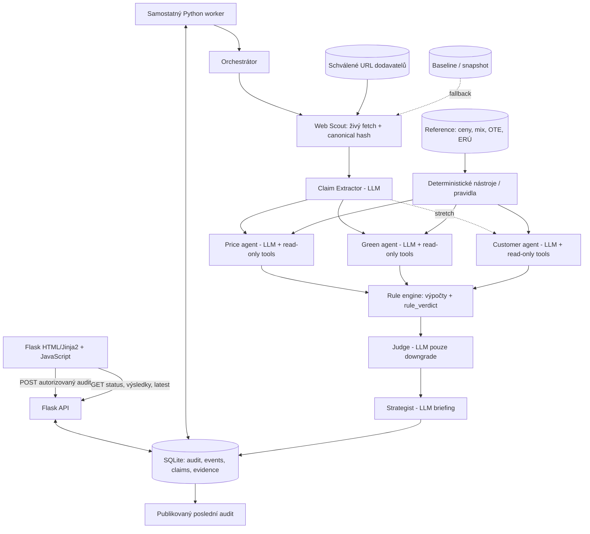

# Fact or Watt — technická architektura v2 (Flask/Python/HTML/JS)

**Původ požadavků:** dodaný dokument „Fact or Watt: architektura v2“, 12. 11. 2026. **Adaptační rozhodnutí:** technologie Next.js/Vercel/TS/Zod jsou nahrazeny Flask/Python/Pydantic/HTML/JS na výslovnou žádost týmu. Dodatečné bezpečnostní a metodické úpravy jsou popsané v `ARCHITECTURE_VALIDATION.md`.

## 1. KIT a KIQ
**KIT:** Kde se marketingová tvrzení konkurenčních dodavatelů elektřiny rozcházejí s ověřitelnými daty a jakou příležitost to dává našemu positioningu?

| KIQ | Manažerská otázka | Agenti |
|---|---|---|
| KIQ1 | Jaká tvrzení konkurenti právě teď komunikují na svých webech? | Web Scout + Claim Extractor |
| KIQ2 | Která cenová tvrzení obstojí proti ceníkům? | Price agent |
| KIQ3 | Která ekologická tvrzení jsou doložená a která nesou možné regulatorní riziko? | Green agent |
| KIQ4 | Odpovídají tvrzení o zákaznících a spolehlivosti veřejným datům? | Customer agent (stretch) |
| KIQ5 | Kde jsou největší mezery a jak je využít? | Judge + Strategist |

## 2. Tok systému



### Role komponent
| Komponenta | Implementace | Vstup | Výstup |
|---|---|---|---|
| API/web | Flask/Jinja2/JS | výběr, autorizace, čtení | job ID, status, dashboard |
| Orchestrátor | čistý Python | audit job + config | průběh, checkpointy, error routing |
| Web Scout | Python HTTP/parser | 2–4 schválené URL na firmu | zdrojová data/hash/`origin` |
| Claim Extractor | LLM | kanonický text | doslovné Claims + katalog rule IDs |
| Price / Green / Customer | LLM se server-side tools | Claim + registry nástrojů | Evidence + zvolená tool calls |
| Deterministic rules | čistý Python | evidenční fakta | `rule_verdict`, metriky, omezení |
| Judge | LLM s omezenými oprávněními | Claim + Evidence + rule_verdict | `final_verdict`, případný downgrade |
| Strategist | LLM | pouze hotové audity | briefing s claim IDs |
| Worker/storage | Python + SQLite/files | job, eventy, snapshoty | trvalý audit / poslední publikovaná verze |

## 3. Režim živého sběru a provenience
`mode=fixture` je offline a neslibuje živá data. `mode=live` při **každém běhu** zkusí bezpečně stáhnout schválené stránky dodavatelů (MVP 2–4 stránky na každou ze 3 firem). Referenční zdroje se nemusejí stahovat při každém auditu — mají kurátorované/verzované podklady a data platnosti.

### Tři větve
1. **Fetch úspěšný, canonical hash odpovídá baseline** a sedí URL/verze parseru/extractoru: použij schválená uložená tvrzení; `origin=baseline`, `fetch_was_live=true`, nevolat znovu LLM Extractor.
2. **Fetch úspěšný, hash se změnil**: `origin=live`; spusť Claim Extractor z nového kanonického textu, `human_reviewed=false`, zobraz změnu a uchovej doslovné citace.
3. **Fetch selhal, byl odepřen nebo bez použitelného textu**: pokud existuje platný snapshot, `origin=snapshot`, `fetch_was_live=false`, `fallback_reason` a čas snapshotu. Jinak zapiš source error; tvrzení nejsou ověřena a nesmí být potichu převzata z jiného dodavatele.

Kanonizace stránky musí být **verzovaná** (vyčistit menu/cookie bannery/jednorázové tokeny, zachovat obsah tvrzení). U baseline nikdy nepřipisuj starším tvrzením čas posledního živého zjištění bez pole `baseline_approved_at`. Snapshoty jsou immutable, hash a source metadata se ukládají odděleně. Nelze-li bezpečně načíst web kvůli robots.txt/ToS, neobcházej ochranu; přiznej fallback.

## 4. Rozhodovací a agentní model
**LLM** extrahuje citát, přiřadí katalogové pravidlo a parametry, volí přístupné evidenční nástroje, kontroluje sémantický soulad a píše briefing. **Kód** parsuje referenční data, počítá matematiku a přiřazuje verdict; žádná LLM odpověď jej nesmí libovolně zlepšit.

Specializované LLM evidence agenty mají vlastní instrukce, vstupní schéma a seznam nástrojů; například `PriceAgent` smí `get_price_offers` a `calculate_annual_cost`, nikoli `get_eru_decisions` bez důvodu. Orchestrátor udělí jednotný tool budget (max calls, timeout, max tokens) a zaznamená názvy nástrojů, bezpečné argumenty a zdrojové IDs. Real tool-calling lze vyhodnotit v golden setu.

`Judge`: kontrola doslovného tvrzení a relevance firmy, produktu, období, scope. Finální verdikt je shodný s `rule_verdict`, nebo pouze `unverifiable`; rozdíl se označí `judge_changed=true`, `judge_reason`. Při chybě Judge u citlivého tvrzení neponechávej nezávisle nevysvětlený kladný závěr.

## 5. Datové zdroje
- **Live reklamní obsah:** weby dodavatelů (HTML, produkty, marketingové landing pages), volitelně aktuální přímé PDF odkazy.
- **Referenční data:** ceníky/obchodní podmínky, ERÚ srovnávač či veřejné exporty jen pokud skutečně dostupné, OTE počty OPM a energetické statistiky, produktový mix/záruky původu, ERÚ rozhodnutí/sankce.
- **Záloha:** kurátorovaná baseline schválených tvrzení + archiv textových snapshotů. Vše s datem platnosti a lokátorem.
- Podrobná hranice mezi kódem (API/scraping/parsing) a agenty je v `DATA_SOURCES.md`.

## 6. Stav auditů, rozhraní a UI
- `POST /api/v1/audits` pouze pro oprávněné uživatele, odpoví `202`, worker běží odděleně. SQLite stavová fronta jen tam, kde je disk opravdu perzistentní.
- UI polluje `GET /api/v1/audits/<id>` a načte `.../results`; `/api/v1/audits/latest` je veřejně čitelný publikovaný poslední audit.
- Stage: `queued → collecting → extracting → verifying → judging → reporting → completed`, možné `failed`/`partial` (v dalších verzích). Eventy obsahují `stage`, `timestamp`, `origin` a lidsky čitelný popis. Jednotlivé nerozhodnutelné claims mohou mít `unverifiable` i při celkově `completed`.
- UI: výběr dodavatelů a odběrového profilu; live průběh; tabulka tvrzení s důkazy, stářím dat, čtyřmi verdikty a briefing. **Žádné globální „skóre pravdivosti“**.

## 7. Doporučená struktura repozitáře
```text
.github/
  copilot-instructions.md
  instructions/{flask-backend,evidence-pipeline,frontend,tests}.instructions.md
app/
  __init__.py                  # create_app
  config.py
  web/{pages,api}.py
  schemas/{claim,evidence,verdict,audit}.py
  models/                     # ORM / sqlite persistence
  services/{orchestrator,web_scout,snapshots,baseline,publication}.py
  connectors/{supplier_web,ote,eru}.py
  parsers/{html,prices,pdf,xlsx}.py
  agents/{extractor,price,green,customer,judge,strategist}.py
  tools/{registry,price_tools,green_tools,customer_tools}.py
  rules/{catalog,price,green,customer,verdicts}.py
  llm/{provider,tool_adapter,prompts}.py
  worker.py
  templates/{index,audit}.html
  static/{js,css}/
config/{suppliers.yaml,profiles.yaml}
data/{baseline,reference,fixtures,raw,snapshots}/
eval/golden.json
tests/                 # anonymizované golden fixtures a unit/integration testy
docs/{ARCHITECTURE,ARCHITECTURE_VALIDATION,API_CONTRACTS,RULE_CATALOG,DATA_SOURCES,IMPLEMENTATION_PLAN,CHANGELOG_V2}.md
.env.example
pyproject.toml
README.md
```
Názvy adresářů jsou plánované. Nedoplňuj prázdné moduly bez implementační potřeby. `data/raw`, pracovní snapshoty, reálná SQLite DB a `.env` nepatří do Gitu; schválené neosobní baseline/fixtures do Gitu patřit mohou.

## 8. Nasazení — důležitá odchylka od předlohy
**Preferované MVP:** Python web service (Gunicorn + Flask), jeden **samostatný worker** a perzistentní volume/SQLite, vše na platformě umožňující běžící proces a zachování dat. Flask dev server jen lokálně.

**Pokud školní zadání explicitně vyžaduje Vercel:** podporuje přímo Flask/Python, není třeba Next.js. Pro serverless ale nepoužívej lokální SQLite/JSON soubory jako permanentní stav ani threads po návratu response. Varianta A: na Vercelu je pouze veřejný read-only Flask viewer posledního publikovaného auditu; audity/worker jinde. Varianta B: plné Vercel Python řešení s perzistentní externí DB + object storage a Queue/Workflow/Daemon (vyžaduje ověřit plán a dostupnost). Nesměšovat tyto varianty s lokálním modelem.

## 9. Reprodukovatelnost, testování a demo
- `fixture` end-to-end včetně interních agentních stubů; `live` musí mít skutečné tool calling pro Price/Green v MVP.
- Golden set 20–30 ručně označených tvrzení: extrakce, klasifikace pravidel a přesnost verdiktu se měří zvlášť. Nevydávej empirická čísla bez naměřených hodnot.
- MVP **musí**: 3 dodavatelé, cena + green, live se zálohou, publikovaný poslední audit, golden set. **Mělo by**: 5 dodavatelů, Customer. **Může**: změnový report a export.
- Při prezentaci živě spustit jednoho dodavatele, další ukázat z publikovaného auditu; `fixture` či `snapshot` vždy jasně označit.

## Zdroje k provozním tvrzením
- GitHub Copilot: https://docs.github.com/en/copilot/how-tos/copilot-in-your-ide/customize-copilot/configure-custom-instructions/add-repository-instructions-in-your-ide
- Flask / Gunicorn: https://flask.palletsprojects.com/en/stable/deploying/gunicorn/
- Vercel Flask: https://vercel.com/kb/guide/ship-a-flask-app-on-vercel
- Vercel functions/filesystem: https://vercel.com/docs/functions/runtimes
