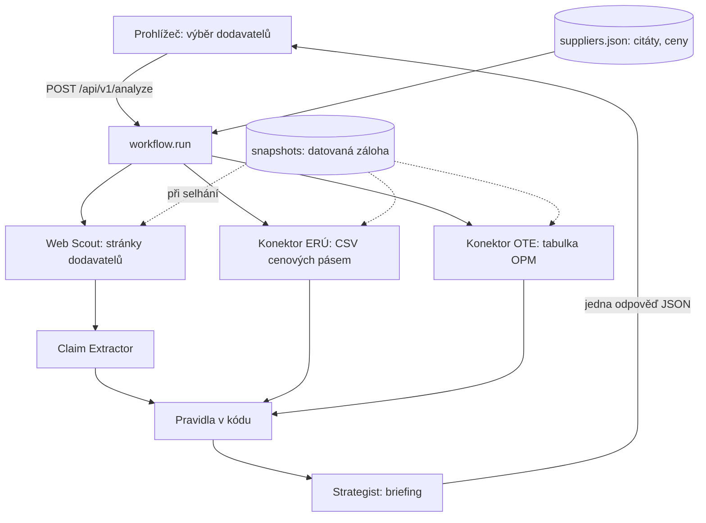

# Fact or Watt — architektura (studentská ukázka)

Tato verze nahrazuje architekturu v3 (Azure SQL, samostatný worker, fronta úloh). Důvod: revize z 13. 11. 2026 doporučila pro studentskou ukázku jednu aplikaci bez databáze a soustředit se na skutečné ověření proti úředním datům.

## Otázka, na kterou ukázka odpovídá

Které tvrzení konkurenta si zaslouží pozornost a co s ním máme udělat?

## Tok jednoho běhu

Vše běží v jednom procesu v rámci jednoho požadavku (typicky několik sekund). Výsledek se nikam neukládá; žije v prohlížeči do obnovení stránky. Uložená ukázka (`example_report.json`) je součástí nasazení.

## Role

| Role | Co dělá | Kde |
|---|---|---|
| Web Scout | Stáhne schválenou stránku, převede na text, spočítá otisk | `connectors/web.py` |
| Claim Extractor | Najde další tvrzení na stránce (model nebo klíčová slova) | `agents.py` |
| Cenová a tržní pravidla | Počítají čísla a verdikty | `rules.py` |
| Strategist | Briefing s nejvýše třemi prioritami (model nebo šablona) | `agents.py` |

Role jsou funkce, ne samostatné služby. Samostatný Judge není; jeho úlohu plní kontroly v kódu.

## Co hlídá kód

- Stahuje se jen ze schválených hostitelů přes HTTPS, s limitem času a velikosti; kontroluje se i cíl přesměrování.
- Rozhraní přijímá jen identifikátory dodavatelů, žádné uživatelské URL.
- CSV ERÚ musí mít očekávané sloupce a konečné kladné hodnoty; duplicitní řádek je chyba.
- Pásmo ERÚ se vybírá pro stejnou sazbu, fixaci a měsíc nabídky. Když neexistuje, verdikt se nevydá (žádná náhrada jiným obdobím).
- Citát od modelu musí doslova existovat ve staženém textu, jinak se zahodí.
- Briefing od modelu smí odkazovat jen na existující tvrzení, jinak se použije šablona.
- Tvrzení nalezená podle klíčových slov (bez modelu) se zobrazí jen jako kandidáti bez verdiktu.

## Původ dat

Každý zdroj ve zprávě nese URL, čas získání, období dat a štítek `live` nebo `snapshot`. Běh je `live` jen tehdy, když byly živě staženy všechny zdroje; jinak `mixed` nebo `snapshot`. Selhání živého stažení se uvádí ve varováních.

## Rozhraní

- `GET /` – stránka.
- `POST /api/v1/analyze` – tělo `{"supplier_ids": [...], "mode": "live" | "snapshot", "code": "..."}`; vrací celou zprávu. `code` je potřeba jen při nastaveném `DEMO_CODE`.
- `GET /api/v1/example` – uložená ukázková zpráva.

## Mimo rozsah

Účty a role, databáze a historie auditů, fronty a plánované úlohy, obecný crawler, právní závěry, celkové skóre dodavatele.
