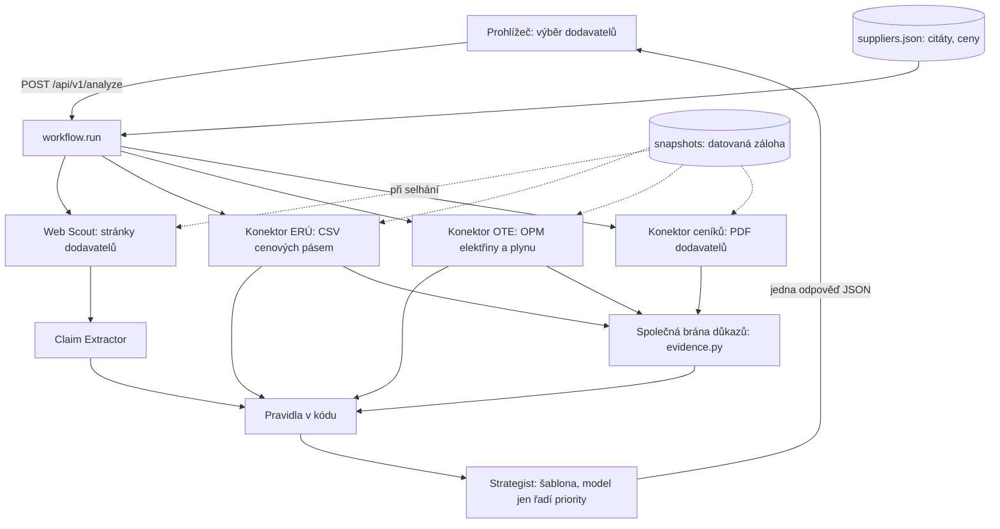

# Fact or Watt — architektura (studentská ukázka)

Tato verze nahrazuje architekturu v3 (Azure SQL, samostatný worker, fronta úloh). Důvod: revize z 13. 11. 2026 doporučila pro studentskou ukázku jednu aplikaci bez databáze a soustředit se na skutečné ověření proti úředním datům.

## Otázka, na kterou ukázka odpovídá

Které tvrzení konkurenta si zaslouží pozornost a co s ním máme udělat?

## Tok jednoho běhu

Vše běží v jednom procesu v rámci jednoho požadavku (typicky několik sekund). Výsledek se nikam neukládá; žije v prohlížeči do obnovení stránky. Uložená ukázka (`example_report.json`) je součástí nasazení.

## Role

| Role | Co dělá | Kde |
|---|---|---|
| Web Scout | Stáhne schválenou stránku, převede na text, spočítá otisk | `connectors/web.py` |
| Claim Extractor | Najde další tvrzení na stránce (model nebo klíčová slova) | `agents.py` |
| Konektor ceníků | Stáhne PDF ceník, převede na text a ověří cenu a stálý plat | `connectors/pricelist.py` |
| Společná brána důkazů | Rozsah tvrzení, oprávněnost nabídek, společné období OTE; každé „ne“ s důvodem | `evidence.py` |
| Cenová a tržní pravidla | Počítají čísla, roční náklad a verdikty | `rules.py` |
| Strategist | Briefing ze šablony; model smí jen seřadit kandidáty určené kódem | `agents.py` |

Role jsou funkce, ne samostatné služby. Samostatný Judge není; jeho úlohu plní kontroly v kódu.

## Co hlídá kód

- Stahuje se jen ze schválených hostitelů přes HTTPS a port 443, s limitem velikosti. Přesměrování se provádí ručně a každý krok se kontroluje dřív, než se na něj pošle požadavek.
- Celý audit má jeden časový limit (`AUDIT_DEADLINE_S`, výchozí 45 s). Limit se předává do vláken (`contextvars`), každé stažení dostane jen zbývající čas a po vypršení se nic nového nezačíná.
- Jedno pravidlo oprávněnosti nabídek (`evidence.offer_eligibility`) pro verdikty, srovnání, rozdíl cen pro nové a stávající zákazníky i pohled firmy.
- Rozhraní přijímá jen identifikátory dodavatelů, žádné uživatelské URL.
- CSV ERÚ musí mít očekávané sloupce a konečné kladné hodnoty; duplicitní řádek je chyba.
- Nabídka, kterou živě stažený ceník nebo stránka už nepotvrzuje, se z verdiktů i srovnání vyřadí a zpráva na to upozorní.
- Srovnávají se jen nabídky se stejnou sazbou, distribučním územím a délkou fixace.
- Pásmo ERÚ se vybírá pro stejnou sazbu, fixaci a měsíc nabídky. Když neexistuje, verdikt se nevydá (žádná náhrada jiným obdobím).
- Citát od modelu musí doslova existovat ve staženém textu, jinak se zahodí.
- Silný verdikt vyžaduje shodu rozsahu tvrzení a podkladu (metrika, komodita, subjekt, období); jinak „nelze ověřit“ s kontextem.
- Model nepíše text briefingu; jeho výběr priorit se přijme jen z kandidátů, které určil kód.
- Tvrzení nalezená podle klíčových slov (bez modelu) se zobrazí jen jako kandidáti bez verdiktu.

## Původ dat

Zpráva obsahuje manifest všech očekávaných zdrojů se stavem `live`, `snapshot`, `missing` nebo `not_required` (ruční podklad). Běh je `live` jen tehdy, když jsou živě všechny očekávané zdroje; jinak `mixed` nebo `snapshot`. Selhání živého stažení se uvádí ve varováních.

## Rozhraní

- `GET /` – stránka.
- `POST /api/v1/analyze` – tělo `{"supplier_ids": [...], "mode": "live" | "snapshot", "perspective": "id", "code": "..."}` validované Pydanticem (neznámá pole a hodnoty → 400). Limity: 8 kB tělo, souběžné audity, živé audity z jedné adresy; na veřejném nasazení bez `DEMO_CODE` je živý audit vypnutý.
- `GET /api/v1/example` – uložená ukázková zpráva.

## Mimo rozsah

Účty a role, databáze a historie auditů, fronty a plánované úlohy, obecný crawler, právní závěry, celkové skóre dodavatele.
